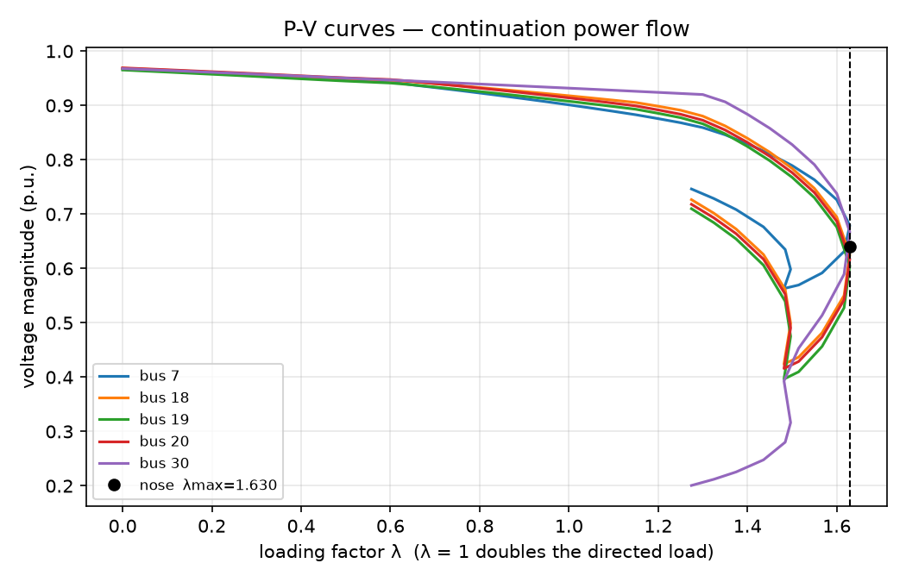

# cpflow

[](tests/)
[](pyproject.toml)
[](LICENSE)

**English** | [简体中文](#cpflow-中文)

**How much more load can this network take before the voltage collapses — and which bus goes first? `cpflow` answers both, with a P-V curve traced past the nose point, in one command, on any pandapower network.**

## Results at a glance

IEEE 30-bus, all loads scaled together at constant power factor:



| case | λmax (with Q limits) | λmax (no switching) | brute force | weakest buses (dV/dλ) | modal top-3 |
|---|---|---|---|---|---|
| case9 | 1.6496 | 1.6496 | 1.64 | 9, 5, 4 | 9, 5, 4 |
| case14 | 1.3304 | 3.9897 | 3.98 | 14, 10, 9 | 14, 10, 9 |
| case30 | 1.6302 | 3.0138 | 3.01 | 19, 30, 20 | 18, 20, 19 |
| case39 | 0.3238 | 0.4253 | 0.42 | 12, 8, 7 | 21, 15, 23 |
| case57 | 0.4329 | 0.4720 | 0.47 | 31, 30, 33 | 31, 30, 33 |
| case118 | 1.5535 | 2.0273 | 2.02 | 52, 53, 51 | 52, 53, 51 |

λmax is the loading factor at the nose: λ = 1 means the directed load has doubled. "Brute force" is an independent check — plain Newton at λ = 0.00, 0.01, 0.02, … with no switching — and it agrees with the continuation to ~0.6% on every case, which is what validates the machinery. Bus numbers are 1-based (IEEE style).

Three findings worth a planner's attention:

1. **Reactive limits, not the fold, usually set the margin.** On case14 the fold is at λ = 3.99, but generator Q limits bite long before it and the margin collapses to 1.33. On case30 the same story: 3.01 → 1.63. Any margin number computed without Q-limit switching is not a margin, it is a wish.
2. **Case9 is the exception that proves the rule.** Its Q limit (bus 2, 300 MVAr) never binds on the upper branch — the generator reaches only 269 MVAr at the nose — so switching changes nothing and λmax = 1.6496 is set by the fold itself.
3. **Case39's nose is angle-driven, not voltage-driven.** At the nose the lowest voltage is still ~0.87 p.u. while generator angles separate by ~0.9 rad, so the Q-V modal ranking (21, 15, 23) disagrees with the dV/dλ ranking (12, 8, 7). When the two methods disagree, trust dV/dλ — the modal method assumes a Q-V collapse.

## Problem

Voltage stability is the question of how much more load a network can serve before voltages collapse — the mechanism behind the 2025 Iberia blackout's aftermath discussions and a standard topic in every power-systems course. The tool for it is the **continuation power flow (CPF)**: scale the load step by step, trace the P-V curve through its nose point (the saddle-node bifurcation), and read off the margin λmax and the weakest buses.

The problem is that the Python ecosystem has no maintained CPF implementation. MATPOWER's `runcpf` is MATLAB-only. pandapower (3.5.6) and PyPSA have power flow and optimal power flow, but no continuation. PyPI has no maintained Python CPF package. A 2026 study on a 2,475-bus real grid (Guangxi) calls per-bus CPF the ground truth for weak-node identification — and the computational bottleneck. Students and researchers working in Python today either re-implement the predictor–corrector from the 1992 paper every time, or do without.

## Method

**Continuation** (`cpflow/cpf.py`). Predictor–corrector in the Ajjarapu & Christy (1992) tradition: a tangent predictor along the solution curve, then a Newton corrector on the augmented system (power-flow equations + one continuation equation), with a backtracking line search on the residual and adaptive step size (grow ×1.3 on success, halve on failure). The continuation parameter is chosen per step from the monotone candidates — λ or a PQ-bus voltage magnitude — never a generator angle, which can turn around mid-curve and stall the corrector. The trace continues past the nose onto the lower branch until voltage falls below 0.5 p.u. or λ has dropped 0.35 below the nose. The nose itself is refined by bisection on plain-Newton feasibility to ~1e-4 in λ.

**Load and generation model.** λ scales all directed loads at constant power factor, `P(λ) = P₀(1 + λw)`. The extra generation is shared among online non-slack generators in proportion to Pmax, clamped at Pmax with redistribution; the slack absorbs the rest (losses and capped units). A single bus's load can be scaled instead (`--bus N`).

**PV → PQ switching.** After each converged step, generators violating their reactive-power limit are switched to PQ with Q fixed at the limit, worst violator first, and the step is re-solved at the same λ. Switches are staged per attempt and rolled back if the retry fails, so a switch detected at a larger λ never survives a smaller-λ retry. Only the upper limit Qmax is enforced by default — see the honesty notes for why Qmin is off.

**Weakest buses** (`cpflow/analysis.py`). Two independent methods: a secant dV/dλ over the last upper-branch steps, and modal analysis (Gao, Morison & Kundur 1992) — smallest eigenvalue of the reduced Jacobian `Jr = J22 − J21·J11⁻¹·J12` with participation factors. They agree on the top bus in 5 of 6 test cases.

**N-1 margin ranking.** Every single-branch outage is re-run through the full CPF; the table reports the remaining λmax and the margin lost. Outages that island a bus or make the base case itself infeasible are reported explicitly instead of silently returning a number.

## Quickstart

```bash
pip install -e .
cpflow case30 --plot pv.png --csv trace.csv
```

```
case case30: lambda_max = 1.6302 (nose found, 44 points, status=lower_branch_done)
monitored bus: 8, V at nose: 0.6403 p.u.
  event: PV->PQ at bus 23 (lambda=1.200, Q limit 40 MVAr)
  ...
weakest buses by |dV/dlambda| near the nose:
 bus   v_nose   dv_dlam
  19 0.6050 -1.2599
  30 0.6673 -1.2438
  ...
```

Python API:

```python
from cpflow import case_to_ppc, run_cpf, weakest_buses, n1_margin_ranking

ppc, net = case_to_ppc("case30")
res = run_cpf(ppc)
print(res.lambda_max)          # 1.6302
print(weakest_buses(res, topn=3))
print(n1_margin_ranking(case_to_ppc("case14")[0]).head(3))
```

`run_cpf` also accepts a pandapower network directly via `net_to_ppc(net)`, a single-bus direction (`load_bus`), an early stop (`lambda_target`), and `enable_switching=False` for cross-checks. `examples/quickstart.py` and `examples/n1_ranking.py` reproduce the tables above.

## N-1 example (IEEE 14-bus)

| branch | λmax | margin lost | status |
|---|---|---|---|
| 7–8 | — | — | islanded (bus 8 has no other connection) |
| 1–2 | 0.0000 | 1.3304 | infeasible_base (base case itself violates Qmax) |
| 2–3 | 0.6786 | 0.6519 | |
| 7–9 | 0.7237 | 0.6068 | |
| … | … | … | |
| base case | 1.3304 | 0 | |

The two most severe outages are degenerate in different, informative ways: 7–8 islands a bus (the Jacobian becomes structurally singular), and 1–2 leaves the base case itself Q-infeasible (the generator at bus 2 would need 83.7 MVAr against a 50 MVAr limit). Both are flagged, not hidden behind a zero.

## Honesty notes / limits

- **One-way switching.** A bus that switches PV → PQ never switches back. In practice a generator can regain voltage control as λ falls on the lower branch; this implementation does not model that, so lower-branch voltages after a switch are indicative, not exact.
- **Qmin is off by default.** Standard case files carry `Qmin = 0` placeholders that the base case itself violates (IEEE 39-bus: the generator at bus 36 absorbs 1.4 MVAr at base load against a `Qmin` of 0), so enforcing Qmin makes the margin depend on a data artefact and on the step grid (case39's switched margin moves between 0.28 and 0.32 depending on when that 1.4 MVAr violation is caught). Pass `enforce_qmin=True` when the case file carries deliberate, verified lower limits.
- **Switching is path-dependent.** The exact switch sequence depends on the step size, so the switched margin carries a few percent of method spread: case39 is 0.3238 by CPF against 0.310 by an independent progressive-switching brute force. The unswitched margin is the tightly verified number (agrees with brute force to ~0.6%).
- **Constant-power-factor scaling, slack absorbs losses.** Loads keep their power factor as they grow; losses and capped generation fall on the slack. Real dispatch would re-dispatch; the margin is a network property under this stated dispatch rule, not a market outcome.
- **Modal analysis assumes a Q-V collapse.** On angle-driven noses (case39) it disagrees with dV/dλ; trust dV/dλ there. The modal eigenvalue is only near zero when the last sampled point lands very close to the fold (case14/30/57: |eig| ≈ 0.015; case9/39: ≈ 0.46, because the sampled point sits further from a sharp fold).
- **Nose refinement assumes no new switch binds** between the last sampled point and the refined nose. The refinement bisects on plain-Newton feasibility with the switch set frozen at the nose point.

## Tests

23 tests, ~1 minute: base power flow against `pandapower.runpp`, Jacobian against finite differences, nose margins on all 6 cases, no-switch CPF against brute force, switching behaviour, single-bus direction, λ-target early stop, islanded/infeasible-base outages, weakest-bus/modal agreement, and the N-1 ranking.

```bash
pip install -e ".[test,plot]"
pytest -q
```

## References

1. Ajjarapu, V. & Christy, C., "The continuation power flow: A tool for steady state voltage stability analysis", *IEEE Transactions on Power Systems*, vol. 7, no. 2, pp. 416–423, 1992.
2. Gao, B., Morison, G. K. & Kundur, P., "Voltage stability evaluation using modal analysis", *IEEE Transactions on Power Systems*, vol. 7, no. 4, pp. 1529–1542, 1992.
3. "Fast Identification of Static Voltage Weak Nodes in Large-Scale Power Grids Using GATv2-JK", *Energies*, vol. 19, no. 20, 4828, 2026 — CPF as ground truth for weak-node identification on a 2,475-bus real grid.
4. "Estimation of the Voltage Stability Margin in Power Systems Under Transmission Line Contingencies Using a Convex Formulation and a Heuristic Approach", *Modelling*, vol. 7, 106, 2026.
5. "Continuation Power Flow: A Parameterization Technique and Adaptive Step Size Control", UNESP — geometric parameterisation with adaptive step control, validated on IEEE 14-bus and a 904-bus real system.

---

# cpflow — 中文

**English** | **简体中文**

**这个电网还能再带多少负荷才会电压崩溃——又是哪个母线先垮？`cpflow` 一条命令就给出答案：在任意 pandapower 网络上追踪 P-V 曲线、越过鼻点，读出电压稳定裕度。**

## 一眼结果

IEEE 30 节点系统，全部负荷按恒功率因数同步增长：


| 算例 | λmax（含无功限值） | λmax（不切换） | 暴力法对照 | 最弱母线（dV/dλ） | 模态分析前三 |
|---|---|---|---|---|---|
| case9 | 1.6496 | 1.6496 | 1.64 | 9, 5, 4 | 9, 5, 4 |
| case14 | 1.3304 | 3.9897 | 3.98 | 14, 10, 9 | 14, 10, 9 |
| case30 | 1.6302 | 3.0138 | 3.01 | 19, 30, 20 | 18, 20, 19 |
| case39 | 0.3238 | 0.4253 | 0.42 | 12, 8, 7 | 21, 15, 23 |
| case57 | 0.4329 | 0.4720 | 0.47 | 31, 30, 33 | 31, 30, 33 |
| case118 | 1.5535 | 2.0273 | 2.02 | 52, 53, 51 | 52, 53, 51 |

λmax 是鼻点处的负荷因子：λ = 1 表示指定负荷翻倍。"暴力法"是独立对照——用普通牛顿法按 λ = 0.00、0.01、0.02… 逐点求解（不切换）——与连续潮流在 6 个算例上都吻合到约 0.6%，这正是算法正确性的验证。母线号为 1 基（IEEE 惯例）。

三个值得规划人员注意的结论：

1. **决定裕度的通常是无功限值，不是鼻点本身。** case14 的鼻点在 λ = 3.99，但发电机无功限值早得多就咬住，裕度塌到 1.33；case30 同理：3.01 → 1.63。不做无功限值切换算出的"裕度"不是裕度，是愿望。
2. **case9 是证明这条规律的例外。** 它的无功限值（母线 2，300 MVAr）在上支路全程不越限——鼻点处发电机只发到 269 MVAr——所以切换与否结果相同，λmax = 1.6496 由鼻点本身决定。
3. **case39 的鼻点是功角主导，不是电压主导。** 鼻点处最低电压仍有约 0.87 p.u.，而发电机功角已拉开约 0.9 rad，所以 Q-V 模态排序（21、15、23）与 dV/dλ 排序（12、8、7）不一致。两种方法打架时，以 dV/dλ 为准——模态法默认的是 Q-V 型崩溃。

## 问题背景

电压稳定问的是：一个电网还能再带多少负荷，电压才会崩溃——这是 2025 年伊比利亚大停电后讨论的焦点，也是每门电力系统课程的标准内容。标准工具是**连续潮流（CPF）**：把负荷一步步放大，追踪 P-V 曲线越过鼻点（鞍结分岔点），读出裕度 λmax 与最弱母线。

问题在于 Python 生态没有可维护的 CPF 实现。MATPOWER 的 `runcpf` 只有 MATLAB 版；pandapower（3.5.6）与 PyPSA 有潮流和最优潮流，但没有连续潮流；PyPI 上也没有维护中的 Python CPF 包。2026 年一篇针对 2475 节点真实电网（广西）的研究明确写道：逐母线 CPF 是弱节点判定的 ground truth，同时也是计算瓶颈。今天用 Python 做这件事的学生和研究者，要么每次都从 1992 年那篇论文重新实现预测–校正法，要么干脆不做。

## 方法

**连续潮流**（`cpflow/cpf.py`）。Ajjarapu & Christy（1992）的预测–校正法：沿解曲线做切线预测，再用牛顿法在增广系统（潮流方程 + 一个连续化方程）上校正，配合基于残差的回溯线搜索与自适应步长（成功 ×1.3、失败减半）。连续化参数每步从单调候选量中选取——λ 或某个 PQ 母线的电压幅值，绝不用发电机功角（功角可能在曲线中途掉头，定住它会让校正器无解）。轨迹越过鼻点进入下支路，直到电压低于 0.5 p.u. 或 λ 回落超过鼻点 0.35。鼻点本身用普通牛顿法可行性二分精修到约 1e-4。

**负荷与发电模型。** λ 按恒功率因数放大指定负荷，`P(λ) = P₀(1 + λw)`；新增发电按 Pmax 比例分给在线非平衡机，触及 Pmax 时截断并再分配；平衡机承担其余部分（网损与被截断的机组）。也支持只放大单个母线的负荷（`--bus N`）。

**PV → PQ 切换。** 每步收敛后检查发电机无功越限，按越限量从大到小逐个把 PV 母线切为 PQ（无功固定在限值上），在同一 λ 下重解。切换按尝试分阶段、失败时回滚，所以大 λ 下发现的切换不会残留到小 λ 的重试里。默认只执行上限 Qmax——原因见诚实说明。

**最弱母线**（`cpflow/analysis.py`）。两种独立方法：鼻点前最后几步的割线 dV/dλ，以及模态分析（Gao, Morison & Kundur 1992）——约化雅可比 `Jr = J22 − J21·J11⁻¹·J12` 的最小特征值与参与因子。6 个算例中有 5 个两种方法的最弱母线一致。

**N-1 裕度排名。** 对每条支路开断重跑完整 CPF，输出剩余 λmax 与裕度损失。造成孤岛或让基态本身不可行的开断会被明确标出，而不是悄悄返回一个数字。

## 快速开始

```bash
pip install -e .
cpflow case30 --plot pv.png --csv trace.csv
```

Python 接口：

```python
from cpflow import case_to_ppc, run_cpf, weakest_buses, n1_margin_ranking

ppc, net = case_to_ppc("case30")
res = run_cpf(ppc)
print(res.lambda_max)          # 1.6302
print(weakest_buses(res, topn=3))
print(n1_margin_ranking(case_to_ppc("case14")[0]).head(3))
```

`run_cpf` 也可直接接受 pandapower 网络（经 `net_to_ppc(net)`）、单母线方向（`load_bus`）、提前停止（`lambda_target`），以及 `enable_switching=False`（用于对照验证）。`examples/quickstart.py` 与 `examples/n1_ranking.py` 可复现上表。

## N-1 示例（IEEE 14 节点）

| 支路 | λmax | 裕度损失 | 状态 |
|---|---|---|---|
| 7–8 | — | — | islanded（母线 8 无其他连接） |
| 1–2 | 0.0000 | 1.3304 | infeasible_base（基态本身越无功限值） |
| 2–3 | 0.6786 | 0.6519 | |
| 7–9 | 0.7237 | 0.6068 | |
| … | … | … | |
| 基态 | 1.3304 | 0 | |

最严重的两条开断以不同方式退化，都值得单独说明：7–8 造成孤岛（雅可比结构性奇异），1–2 让基态本身无功不可行（母线 2 的发电机需发 83.7 MVAr，限值 50 MVAr）。两者都被标出，而不是藏在一个 0 后面。

## 诚实说明 / 局限

- **切换是单向的。** 切为 PQ 的母线不会再切回 PV。实际中发电机在下支路 λ 回落时可能恢复电压控制；本实现不模拟这一点，所以切换后的下支路电压仅供参考，不作精确值。
- **Qmin 默认关闭。** 标准算例文件里的 `Qmin = 0` 多是占位值，基态本身就违反（IEEE 39 节点：母线 36 的发电机在基态吸收 1.4 MVAr，而 `Qmin` 写的是 0），执行 Qmin 会让裕度取决于数据瑕疵和步长网格（case39 的切换后裕度会在 0.28–0.32 之间飘）。算例文件里的下限是经过核实的 deliberate 值时，传 `enforce_qmin=True` 即可开启。
- **切换有路径依赖性。** 切换顺序取决于步长，所以切换后的裕度有百分之几的方法学浮动：case39 用 CPF 是 0.3238，用独立的渐进切换暴力法是 0.310。不切换的裕度是被严格验证的数字（与暴力法吻合到约 0.6%）。
- **恒功率因数放大、平衡机兜底。** 负荷增长时保持功率因数；网损与被截断的发电由平衡机承担。真实调度会重新调配；这里的裕度是该调度规则下的网络属性，不是市场结果。
- **模态分析默认 Q-V 型崩溃。** 在功角主导的鼻点（case39）上它与 dV/dλ 不一致，以 dV/dλ 为准。模态特征值只有当最后一个采样点离鼻点足够近时才接近零（case14/30/57：|特征值| ≈ 0.015；case9/39：≈ 0.46，因为采样点离陡峭鼻点较远）。
- **鼻点精修假设**最后一个采样点到精修鼻点之间没有新的无功限值切换。精修时开关状态冻结在鼻点处，用普通牛顿法可行性做二分。

## 测试

23 个测试，约 1 分钟：基态潮流对照 `pandapower.runpp`、雅可比对照有限差分、6 个算例的鼻点裕度、不切换 CPF 对照暴力法、切换行为、单母线方向、λ 目标提前停止、孤岛/基态不可行开断、最弱母线与模态分析一致性、N-1 排名。

```bash
pip install -e ".[test,plot]"
pytest -q
```

## 参考文献

1. Ajjarapu, V. & Christy, C., "The continuation power flow: A tool for steady state voltage stability analysis", *IEEE Transactions on Power Systems*, vol. 7, no. 2, pp. 416–423, 1992.
2. Gao, B., Morison, G. K. & Kundur, P., "Voltage stability evaluation using modal analysis", *IEEE Transactions on Power Systems*, vol. 7, no. 4, pp. 1529–1542, 1992.
3. "Fast Identification of Static Voltage Weak Nodes in Large-Scale Power Grids Using GATv2-JK", *Energies*, vol. 19, no. 20, 4828, 2026——在 2475 节点真实电网上以 CPF 作为弱节点判定的 ground truth。
4. "Estimation of the Voltage Stability Margin in Power Systems Under Transmission Line Contingencies Using a Convex Formulation and a Heuristic Approach", *Modelling*, vol. 7, 106, 2026.
5. "Continuation Power Flow: A Parameterization Technique and Adaptive Step Size Control", UNESP——几何参数化与自适应步长控制，在 IEEE 14 节点与 904 节点真实系统上验证。
